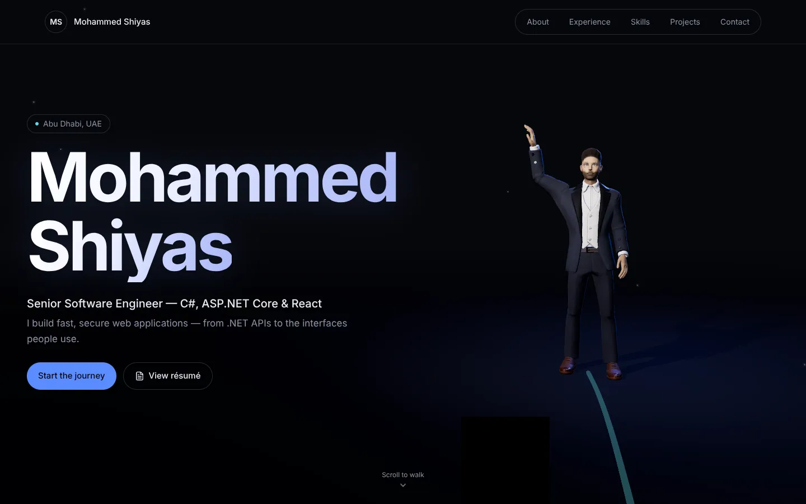
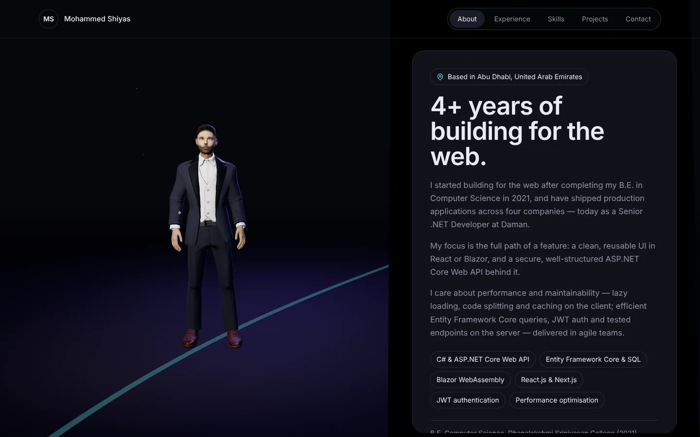
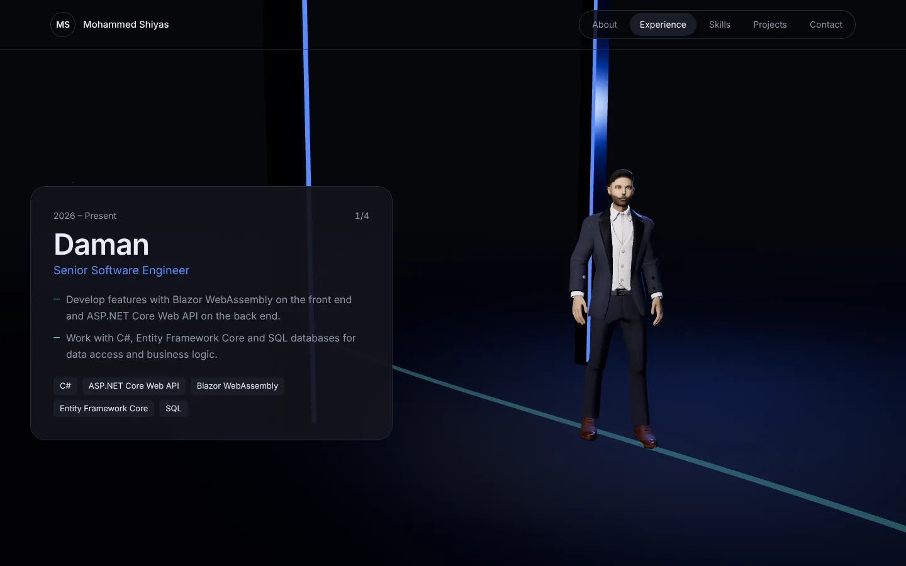
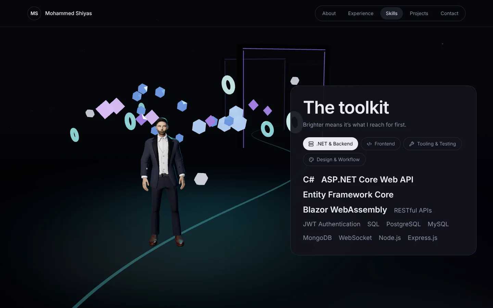
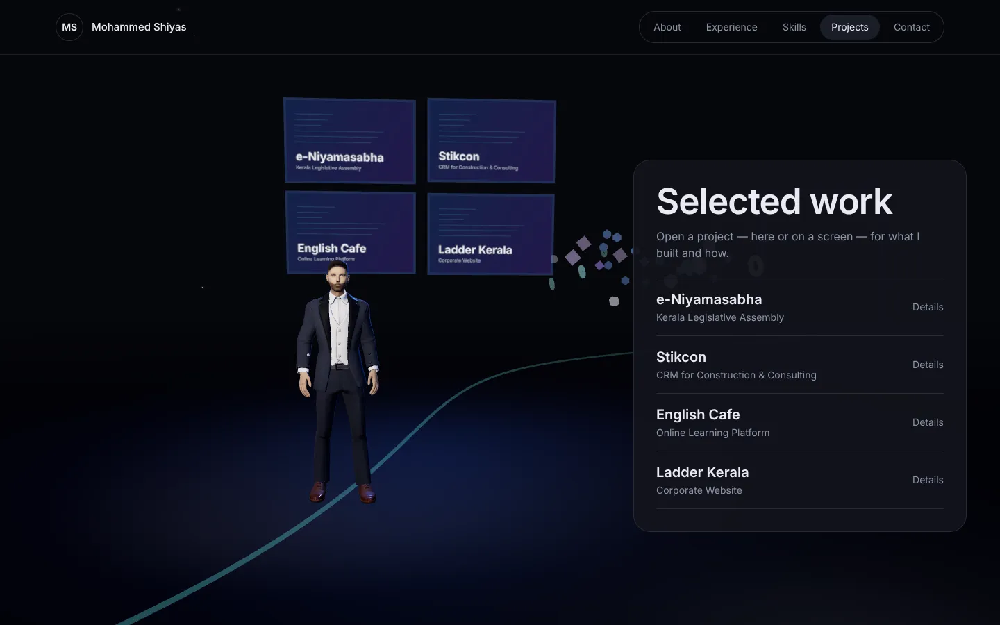
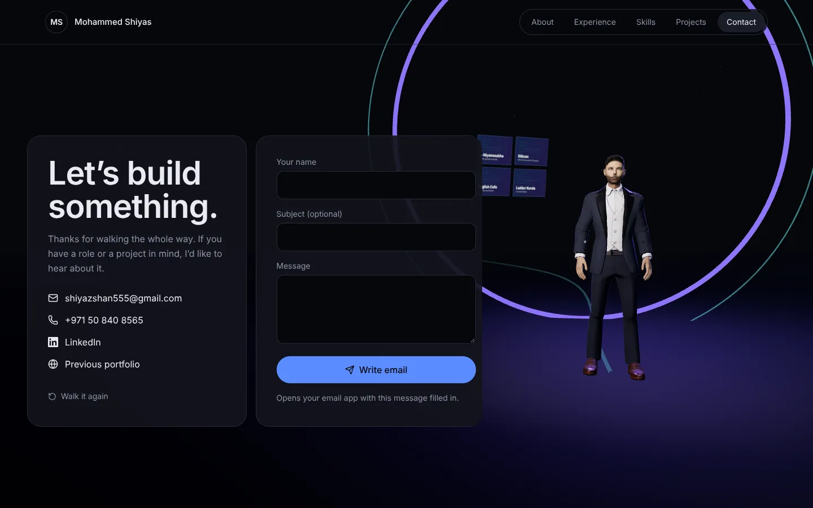
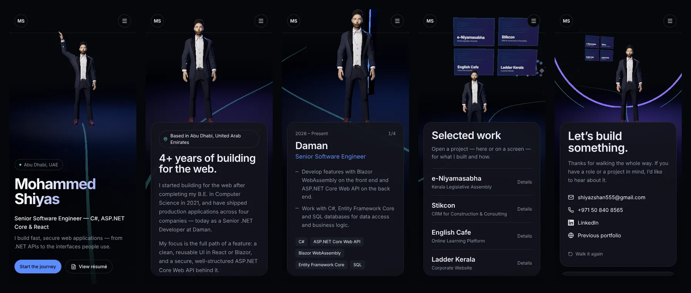

<div align="center">

# Mohammed Shiyas — 3D Career Journey

**An interactive 3D portfolio. Scroll, and a 3D version of me walks you through my career.**

Senior Software Engineer · C#, ASP.NET Core & React · Abu Dhabi, UAE

<!-- Replace with your Vercel URL after deploying -->
**[View the live site →](https://your-vercel-url.vercel.app)**



</div>

---

## What it is

A single-page portfolio built as a scroll-driven 3D scene. As you scroll, my avatar walks along a path of light and stops at each chapter: About, four roles, Skills, Projects and Contact. At each stop he turns to face you while the content appears beside him. Scroll back up and the whole journey plays in reverse.

It's a **static, frontend-only** site. There's no backend, database or API: all content lives in a few local data files, and the contact form opens your email app with a `mailto:` link.

## Highlights

- **A walking, motion-captured human avatar.** Real Walk and Idle animation clips. The walk is driven by distance travelled, so his feet stay planted at any scroll speed and he walks backwards when you scroll up.
- **Cinematic camera.** One GSAP timeline, tied to the scroll bar, drives the walk, the camera and the lighting colour. The camera orbits him rather than cutting through him.
- **Says hello.** He waves when the page first loads, then settles into a natural idle pose.
- **Clickable 3D project wall.** Every project appears on a screen in the 3D world. Click a screen, or the list beside it, to open the project details.
- **Fully responsive.** A stacked layout on upright phones and tablets, side by side on laptops and landscape screens, with panels that scroll inside themselves on short screens.
- **Tuned for phones.** Lighter materials, capped pixel density and fewer particles on mobile. The quality also drops automatically if a device can't hold a smooth frame rate.
- **Accessible.** All content is real HTML outside the 3D canvas, keyboard navigation works, `prefers-reduced-motion` is respected, and there's a text-only fallback when WebGL isn't available.

## Screenshots

| About | Experience |
|---|---|
|  |  |
| **Skills** | **Projects** |
|  |  |
| **Contact** | |
|  | |

### On mobile



## Tech stack

| Area | Tools |
|---|---|
| UI | React 19, Vite, Tailwind CSS v4, Lucide icons |
| 3D | Three.js, React Three Fiber, drei |
| Motion | GSAP ScrollTrigger (the scroll journey), Lenis (smooth scrolling), Motion (UI transitions) |
| Avatar pipeline | glTF Transform + sharp (build script that restyles and packs the character) |
| Hosting | Any static host — configured for Vercel |

## Getting started

Requires Node.js 18 or newer.

```bash
cd frontend
npm install
npm run dev        # http://localhost:5173
npm run build      # production build in frontend/dist
npm run preview    # serve the production build locally
```

## Deploy to Vercel

```bash
cd frontend
npx vercel@latest --prod
```

The first run asks you to log in; then accept the detected settings (they're already in `frontend/vercel.json`).

You can also import the GitHub repository on vercel.com with **Root Directory = `frontend`**, and every push will deploy automatically.

The build uses relative paths, so the same output also works on Netlify or GitHub Pages.

## Project structure

```
frontend/
├─ public/
│  ├─ models/avatar.glb            the 3D avatar (Walk + Idle clips included)
│  └─ Mohammed_Shiyas_Resume.pdf   served by "View résumé"
├─ scripts/build-avatar.mjs        rebuilds avatar.glb from its source files
├─ vercel.json
└─ src/
   ├─ data/          profile · experience · skills · projects   ← edit these to update the site
   ├─ lib/           journeyConfig (path, stops, camera framing) · journeyStore
   ├─ hooks/         useScrollJourney (Lenis + the scroll timeline) · useEnvironment
   └─ components/
      ├─ 3d/         Scene · Avatar · CameraRig · ExperienceWorld · avatarAccessories
      ├─ sections/   Hero · About · Experience · Skills · Projects · Contact
      └─ ui/         Nav · Loader · Chapter · Button · Icons
docs/screenshots/    images used in this README
```

## Updating the content

Everything visitors read lives in `frontend/src/data/`:

| File | What it holds |
|---|---|
| `profile.js` | name, title, location, introduction, strengths, education, contact links |
| `experience.js` | roles, newest first |
| `skills.js` | skill categories; `primary: true` makes an item stand out |
| `projects.js` | projects; set `liveUrl` / `sourceUrl` to show "Visit site" / "Source code" buttons |

A GitHub link appears in Contact as soon as `contact.github` is filled in. Each chapter's camera shot is set in `src/lib/journeyConfig.js → STOPS`, and adding a role means adding one more `exp-*` stop there.

## How it works

1. **One timeline for the whole page.** `useScrollJourney` builds a single GSAP timeline whose progress equals the scroll position. Each chapter's position is measured from the page, so he always arrives just as its panel appears.
2. **No React re-renders per frame.** The timeline only changes numbers on a plain shared object (his position on the path, the camera's angle and distance). The 3D components read that object every frame. It's the same idea as using `useRef` instead of `useState` for values that change constantly.
3. **No foot sliding.** The Walk clip covers 3.21 m per loop, so it's advanced by exactly the distance he moves along the path.
4. **Hair and glasses.** These are generated from the avatar's head mesh when the page loads, and attached to his head bone so they follow every movement.

## Credits

- **Avatar:** a Ready Player Me character from the three.js examples, restyled by `scripts/build-avatar.mjs` (formal outfit, skin tone, beard, hair, spectacles).
- **Animation:** Walk and Idle from the Ready Player Me Animation Library. Its licence permits use with Ready Player Me avatars.
- **Fonts:** Sora and Bricolage Grotesque, via Google Fonts.

---

<div align="center">

**Mohammed Shiyas** · Abu Dhabi, UAE
[LinkedIn](https://www.linkedin.com/in/mohammed-shiyas/) · [shiyazshan555@gmail.com](mailto:shiyazshan555@gmail.com)

</div>
